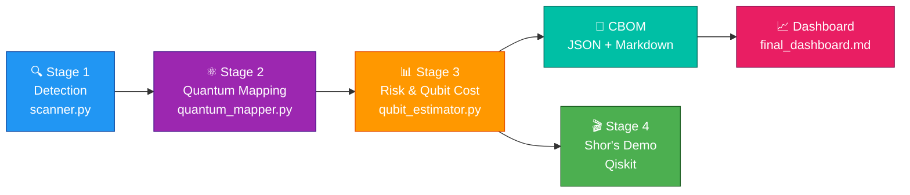

<div align="center">


### 🔐 Find the crypto that quantum computers will break, and know what to replace it with

<br>


<br>

🎓 *Final-year B.Tech CSE project · Hindustan College of Science and Technology, Mathura (AKTU)*

[Overview](#-overview) •
[Threat](#%EF%B8%8F-the-quantum-threat-at-a-glance) •
[Pipeline](#-pipeline) •
[Results](#-results-on-two-real-projects) •
[Quick Start](#-quick-start) •
[Honesty](#-what-this-does-and-does-not-show) •
[Team](#-team)

</div>

---

## 🌟 Overview

Today's public-key cryptography (**RSA, ECC, DSA, Diffie-Hellman**) is safe only because classical computers cannot factor large numbers or solve discrete logarithms fast enough. **Shor's algorithm** on a large quantum computer removes that protection. Symmetric primitives (**AES, SHA**) are hit far less: **Grover's algorithm** only roughly halves their effective strength.

> 💡 You cannot migrate what you cannot find. This project is a **four-stage pipeline** that scans code, maps every finding to the quantum algorithm that threatens it, estimates the qubit cost, and produces a **Cryptographic Bill of Materials (CBOM)** with a post-quantum replacement for each component.

| | Stage | Question it answers |
|:-:|:---|:---|
| 🔍 | **Detect** | Where does this codebase use quantum-vulnerable cryptography? |
| ⚛️ | **Map** | Which quantum algorithm breaks each primitive, Shor's or Grover's? |
| 📊 | **Estimate** | How many qubits would an attack need? Is there a classical weakness too? |
| 🛡️ | **Migrate** | Which post-quantum algorithm should replace it? (target: **ML-KEM-768**) |

The pipeline is validated on **two real student projects** that use textbook RSA with no padding, and it ends with a working **Shor's algorithm demo** (N = 15 and N = 21) on the Qiskit simulator.

---

## ⚛️ The Quantum Threat at a Glance

| Primitive | Broken by | Impact | Severity |
|:---|:---:|:---|:---:|
| **RSA** | Shor's | Completely broken | 🔴 Critical |
| **ECC** (ECDSA, ECDH, EdDSA) | Shor's | Completely broken | 🔴 Critical |
| **DSA / Diffie-Hellman** | Shor's | Completely broken | 🔴 Critical |
| **AES** | Grover's | Effective key strength roughly halved | 🟡 Moderate |
| **SHA-2 / SHA-3** | Grover's | Effective strength roughly halved | 🟡 Moderate |
| **SHA-1 / MD5** | Classical attacks | Already broken today | ⚫ Legacy |

> 🧠 **Rule of thumb:** AES-128 drops to about 64-bit effective strength, so use AES-256. Public-key cryptography cannot be patched with a bigger key. It must be **replaced** by post-quantum algorithms.

---

## 🧭 Pipeline



| # | Stage | What it does | Key files |
|:-:|:---|:---|:---|
| 1️⃣ | 🔍 **Detection** | Scans source code for crypto usage and extracts key sizes | `src/scanner.py`, `src/extra_patterns.py`, `src/key_size.py`, `src/run_all.py` |
| 1️⃣ | 🕵️ **Edge cases** | Flags missing padding, indirect usage and weak keys | `src/edge_cases.py`, `src/key_strength_check.py` |
| 2️⃣ | ⚛️ **Quantum mapping** | Routes each primitive to Shor's or Grover's | `src/quantum_mapper.py` |
| 3️⃣ | 📊 **Risk & qubit cost** | Shor qubits `q ≈ 2n + 3`, Grover halving, risk report | `notebook/qubit_estimator.py`, `generate_risk_report.py` |
| 3️⃣ | 🧾 **CBOM** | One entry per component, validated against a JSON schema | `src/cbom.py`, `schemas/cbom.schema.json` |
| 4️⃣ | 🎬 **Demo** | Shor's order-finding circuit on the Aer simulator | `notebook/shors_demo.py` |

---

## 🔍 Stage 1: Detection Engine

A static scanner that reads code line by line and matches **48 signature patterns** across six primitive families.

<details>
<summary><b>👉 What it detects</b></summary>

<br>

| Family | Examples |
|:---|:---|
| 🔑 **RSA** | Library keygen (PyCryptodome, `cryptography`, python-rsa, Java, `openssl genrsa`) and **hand-rolled textbook RSA** (`phi = (p-1)*(q-1)`, `pow(m, e, n)`, `mod_inverse`, `65537`) |
| 🌀 **ECC** | `ec.generate_private_key`, ECDSA, ECDH, X25519, Ed25519, named curves (SECP256R1, P-256) |
| ✍️ **DSA / DH** | `dsa.generate_private_key`, `dh.generate_parameters`, Java `KeyPairGenerator` |
| 🔒 **AES** | `AES.new`, AESGCM, Fernet, Java `Cipher`, ECB mode (flagged as classically weak) |
| #️⃣ **SHA** | `hashlib.sha256`, SHA-3, PyCryptodome, Java `MessageDigest`, plus SHA-1 / MD5 flagged as already broken |

</details>

<details>
<summary><b>👉 Smart key-size extraction</b></summary>

<br>

- Resolves values held in variables, constants and function defaults (`getPrime(half)` → `half = key_size // 2` → `key_size = 1024`).
- Separates **per-prime size** from **modulus size** (modulus = 2 × prime size).
- Reads wrapper calls such as `generate_keypair(bits=128)`.
- Stays inside the current call, so it never borrows a number from a neighbouring function.

</details>

<details>
<summary><b>👉 Finding format</b></summary>

<br>

```json
{
  "project": "Final-Year-project-part1",
  "file": "app.py",
  "line": 239,
  "primitive": "RSA",
  "pattern_id": "RSA-WRAPPER-CALL",
  "confidence": "medium",
  "key_size": 128,
  "modulus_bits": 256,
  "size_basis": "keyword argument (per-prime assumed, modulus = 2 x)",
  "snippet": "pub, priv = generate_keypair(bits=128)"
}
```

</details>

---

## 📈 Results on Two Real Projects

The pipeline was run on `Final-Year-project-part1` and `Secure-Video-Steganography`.

| Metric | Value |
|:---|:---:|
| 🔎 Total findings | **31** |
| 🔑 RSA findings (Shor's) | **30** |
| #️⃣ SHA findings (Grover's) | **1** |
| 🧾 CBOM entries | **6** |
| ⚠️ Entries with a classical key-strength problem | **2** |
| ❓ Entries with unknown key size | **2** |
| 🧪 Automated tests | **421** passing |

**Risk summary** (logical-qubit estimates, no error-correction overhead):

| CBOM entry | Modulus size | Logical qubits (2n + 3) | Classical risk | Padding | Recommended |
|:---:|:---:|:---:|:---:|:---:|:---:|
| CBOM-002 | 8-bit | 19 | 🔴 Practically breakable | None (textbook RSA) | ML-KEM-768 |
| CBOM-003 | 256-bit | 515 | 🔴 Practically breakable | None (textbook RSA) | ML-KEM-768 |
| CBOM-005 | 2048-bit | 4099 | 🟢 Meets minimum | None (textbook RSA) | ML-KEM-768 |
| CBOM-001, CBOM-004 | unknown | - | unknown | None (textbook RSA) | ML-KEM-768 |

> The 8-bit, 256-bit and 2048-bit sizes come from confirmed manual review (`data/manual_facts.json`, see `docs/size_decisions.md`). Findings without a visible key size are listed as unknown instead of guessed.

> 📄 Full details: [`docs/final_dashboard.md`](docs/final_dashboard.md) · [`docs/cbom.md`](docs/cbom.md) · [`docs/risk_report.md`](docs/risk_report.md) · [`docs/final_report.md`](docs/final_report.md)

---

## 🚀 Quick Start

**Requirements:** Python 3.10+. Stages 1 to 3 use only the standard library. The Shor's demo needs Qiskit and the Aer simulator.

```bash
# 1. Clone with the two target repositories (git submodules)
git clone --recurse-submodules https://github.com/VaibhavGautam01/PQC-Migration-System.git
cd PQC-Migration-System

# 2. Create an environment and install dependencies
python -m venv venv
venv\Scripts\activate          # Windows
# source venv/bin/activate     # Linux / macOS
pip install -r requirements.txt

# 3. Run the whole pipeline: scan -> map -> estimate -> report -> tests
python run_pipeline.py
```

If the target folders are empty, run `git submodule update --init`.

<details>
<summary><b>👉 Run each stage on its own</b></summary>

<br>

```bash
# Map findings to quantum algorithms and write the mapping report
python src/quantum_mapper.py outputs/findings.json outputs/mapped_findings.json docs/mapping_report.md --overrides data/manual_facts.json

# Build the CBOM (JSON + Markdown) and check that the outputs agree
python src/cbom.py outputs/findings.json --facts data/manual_facts.json --json docs/cbom.json --md docs/cbom.md --check

# Build the final dashboard
python src/build_dashboard.py outputs/findings.json --facts data/manual_facts.json --demo data/demo_results.json --out docs/final_dashboard.md

# Run all tests
python run_tests.py
```

</details>

<details>
<summary><b>👉 Shor's algorithm demo</b></summary>

<br>

```bash
python notebook/shors_demo.py --case 15      # 15 = 3 x 5
python notebook/shors_demo.py --case 21      # 21 = 3 x 7
python notebook/shors_demo.py --pause        # step by step, for live presentation
```

Shor's algorithm is probabilistic. Not every shot finds the factors, and that is normal.

</details>

<details>
<summary><b>👉 Interactive dashboard</b></summary>

<br>

```bash
 streamlit run src/live_dashboard.py
```

</details>

---

## 🧱 Project Structure

```text
PQC-Migration-System/
├── src/
│   ├── scanner.py              # Stage 1: core scanner and CLI
│   ├── extra_patterns.py       # ECC, DSA, DH, AES, SHA patterns
│   ├── key_size.py             # key-size and modulus extraction
│   ├── edge_cases.py           # padding and indirect-usage checks
│   ├── key_strength_check.py   # classical weak-key check (< 2048-bit)
│   ├── quantum_mapper.py       # Stage 2: primitive -> Shor / Grover
│   ├── cbom.py                 # CBOM builder, validator, Markdown renderer
│   ├── build_dashboard.py      # final dashboard generator
│   ├── live_dashboard.py       # Streamlit dashboard (live)
│   └── run_all.py              # merges both scans into findings.json
├── notebook/
│   ├── qubit_estimator.py      # Stage 3: Shor q = 2n + 3, Grover halving
│   └── shors_demo.py           # Stage 4: Shor's demo (N = 15, 21)
├── schemas/cbom.schema.json    # JSON Schema for the CBOM
├── tests/                      # unit tests and scanner fixtures
├── data/                       # manual facts, demo results template, targets
├── docs/                       # reports, CBOM, dashboard, weekly summaries
├── outputs/findings.json       # Stage 1 output, input for Stages 2 and 3
├── generate_risk_report.py     # builds docs/risk_report.md
├── run_pipeline.py             # whole pipeline in one command
├── run_tests.py                # all tests in one command
└── requirements.txt
```

---

## 🧭 What This Does and Does Not Show

Being clear about limits is part of the work.

| ✅ Shows | ⚠️ Does not show |
|:---|:---|
| A repeatable way to find quantum-vulnerable crypto in code and rank it | That RSA-1024 or RSA-2048 can be broken today |
| Shor's algorithm working on a **simulator at toy sizes** (N = 15, 21) | Real quantum hardware results |
| Logical-qubit estimates from the 2n + 3 circuit | Physical-qubit counts. These are far larger once error correction is included. |
| Padding and small-key problems reported **separately** from the quantum score | That textbook RSA is dangerous because of Shor's. It is dangerous because it is deterministic. |
| Grover's as a quadratic speed-up | A full break of AES or SHA |

- The scanner is **pattern-based** (rule-based). It can miss crypto that is loaded dynamically or obfuscated.
- Key sizes the scanner cannot see come from manual review (`data/manual_facts.json`). Unverified sizes are labelled as such.
- Only two target projects were analysed, so results illustrate the method and do not support statistical claims.
- Recommendations are at algorithm level. No migration was performed on the target code.

---

## 🛣️ Future Work

- [ ] Prototype a hybrid migration (ML-KEM-768 key establishment with AES-256-GCM) on one target project
- [ ] Support more languages and libraries, and run the scanner in CI
- [ ] Export the CBOM in a standard format such as CycloneDX
- [ ] Replace logical-qubit estimates with full resource estimates including error correction

---

## 👥 Team

<div align="center">

| Member | Role |
|:---|:---|
| 🧑‍💻 **Tarun Saxena** | Detection Engine Lead and Repository Owner |
| 🕵️ **Vaibhav Gautam** | Edge-Case and Vulnerability Detection |
| 🧾 **Uday Pratap Singh** | Migration Advisor and Reporting |
| ⚛️ **Yatharth Raghuvanshi** | Risk Scoring and ML (qubit estimates, Shor's demo) |

</div>

---

## 📚 References

- Shor, P. W. (1997). Polynomial-time algorithms for prime factorization and discrete logarithms on a quantum computer. *SIAM J. Comput.* 26(5).
- Grover, L. K. (1996). A fast quantum mechanical algorithm for database search. *STOC*.
- Beauregard, S. (2003). Circuit for Shor's algorithm using 2n+3 qubits. *Quantum Information & Computation* 3(2).
- Gidney, C. and Ekera, M. (2021). How to factor 2048 bit RSA integers in 8 hours using 20 million noisy qubits. *Quantum* 5, 433.
- NIST FIPS 203 (ML-KEM) and FIPS 204 (ML-DSA), 2024.

<div align="center">

<br>


**⭐ If this project helped you, consider starring the repo.**

</div>
