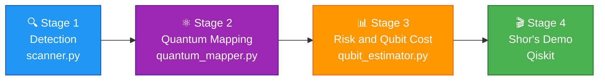

# AI-Powered PQC Migration Advisor: Quantum-Vulnerability Testing Pipeline

Final-year B.Tech CSE project, Hindustan College of Science and Technology, Mathura (AKTU).

The pipeline scans a codebase for classical cryptography, works out which quantum algorithm threatens each finding, estimates the logical-qubit cost, and produces a Cryptographic Bill of Materials (CBOM) with a post-quantum migration recommendation for every component. It was run on two target projects: `Final-Year-project-part1` and `Secure-Video-Steganography`.

## Team

| Member | Role |
|---|---|
| Tarun Saxena | Detection engine lead and repository owner |
| Vaibhav Gautam | Edge-case and vulnerability detection |
| Uday Pratap Singh | Migration advisor and reporting |
| Yatharth Raghuvanshi | Risk scoring and ML (qubit estimates, Shor's demo) |

## How it works

```
scanner -> findings.json -> edge-case flags merged in
                          -> quantum_mapper (Shor's / Grover's, PQC replacement)
                          -> qubit estimates (Shor 2n+3, logical qubits)
                          -> cbom (JSON + Markdown)
                          -> final_dashboard.md


<br>

🎓 *Final-year B.Tech CSE project · Hindustan College of Science and Technology, Mathura (AKTU)*

[Overview](#-overview) · [Threat](#%EF%B8%8F-the-quantum-threat-at-a-glance) · [Pipeline](#-pipeline) · [Status](#-project-status) · [Quick Start](#-quick-start) · [Team](#-team)

</div>

---

## 🌟 Overview

Today's public-key cryptography (**RSA, ECC, DSA, Diffie-Hellman**) is secure only because classical computers cannot factor large numbers or solve discrete logarithms fast enough. **Shor's algorithm** on a large quantum computer removes that protection. Symmetric primitives (**AES, SHA**) are affected less: **Grover's algorithm** roughly halves their effective strength.

Organisations cannot migrate what they cannot find. This project is a **four-stage pipeline** that:

| | Stage | Question it answers |
|:-:|:---|:---|
| 🔍 | **Detect** | Where does this codebase use quantum-vulnerable cryptography? |
| ⚛️ | **Map** | Which quantum algorithm breaks each primitive (Shor's or Grover's)? |
| 📊 | **Estimate** | How many qubits would an attack need? Is there a classical weakness too? |
| 🛡️ | **Migrate** | Which post-quantum algorithm should replace it? (target: **ML-KEM-768**) |

We validate the pipeline on **two real student projects** that use textbook RSA with no padding, and finish with a working **Shor's algorithm demo** (N = 15 and N = 21) on the Qiskit simulator.

---

## ⚛️ The Quantum Threat at a Glance

| Primitive | Broken by | Impact | Severity |
|:---|:---:|:---|:---:|
| **RSA** | Shor's | Completely broken | 🔴 Critical |
| **ECC** (ECDSA, ECDH, EdDSA) | Shor's | Completely broken | 🔴 Critical |
| **DSA / DH** | Shor's | Completely broken | 🔴 Critical |
| **AES** | Grover's | Effective key strength roughly halved | 🟡 Moderate |
| **SHA-2 / SHA-3** | Grover's | Effective strength roughly halved | 🟡 Moderate |
| **SHA-1 / MD5** | Classical attacks | Already broken today | ⚫ Legacy |

> 💡 **Rule of thumb:** AES-128 drops to about 64-bit effective strength, so use AES-256. Public-key cryptography cannot be patched by a bigger key, it must be **replaced** by post-quantum algorithms.

---

## 🧭 Pipeline



| # | Stage | What it does | Files | Status |
|:-:|:---|:---|:---|:-:|
| 1️⃣ | 🔍 **Detection** | Scans source code for crypto usage, extracts key sizes | `src/scanner.py`, `src/extra_patterns.py`, `src/key_size.py`, `src/run_all.py` | ✅ Done |
| 1️⃣ | 🕵️ **Edge cases** | Missing padding, indirect usage, weak keys | `src/edge_cases.py`, `src/key_strength_check.py` | ✅ Done |
| 2️⃣ | ⚛️ **Quantum Mapping** | Maps each primitive to Shor's or Grover's | `src/quantum_mapper.py` | ✅ Done |
| 3️⃣ | 📊 **Risk and Qubit Cost** | Qubit estimates (Shor: `q ≈ 2n + 3`), risk report, CBOM | `notebook/qubit_estimator.py`, `generate_risk_report.py` | ✅ Done |
| 4️⃣ | 🎬 **Demo** | Shor's algorithm on the Qiskit simulator | `notebook/shors_demo.py` | ✅ Done |

---

## 📈 Project Status

4-week sprint, tracked on the **GitHub Kanban board** and **Issues**.

| Week | Status | Focus |
|:-:|:-:|:---|
| **Week 1** | ✅ Done | Repo setup, general-purpose detection engine, `findings.json` v1. [Summary](docs/week1_summary.md) |
| **Week 2** | ✅ Done | Real-data validation, unit tests, Shor's demo (N = 15, 21), merge into `main` |
| **Week 3** | ✅ Done | Risk scoring, qubit-cost numbers, CBOM, ML-KEM-768 recommendation. [Risk report](docs/risk_report.md) |
| **Week 4** | 🔄 In progress | Dashboard, final report, demo recordings, timed rehearsal. [Final report](docs/final_report.md) |

## 🔍 Stage 1: Detection Engine

A static scanner that walks a codebase line by line and matches **47 signature patterns** across six primitives.

**What it detects**

| Family | Examples |
|:---|:---|
| 🔑 **RSA** | Library keygen (PyCryptodome, `cryptography`, python-rsa, Java, `openssl genrsa`) and **hand-rolled textbook RSA** (`phi = (p-1)*(q-1)`, `pow(m, e, n)`, `mod_inverse`, `65537`) |
| 🌀 **ECC** | `ec.generate_private_key`, ECDSA, ECDH, X25519, Ed25519, named curves (SECP256R1, P-256) |
| ✍️ **DSA / DH** | `dsa.generate_private_key`, `dh.generate_parameters`, Java `KeyPairGenerator` |
| 🔒 **AES** | `AES.new`, AESGCM, Fernet, Java `Cipher`, ECB mode (flagged as classically weak) |
| #️⃣ **SHA** | `hashlib.sha256`, SHA-3, PyCryptodome, Java `MessageDigest`, plus SHA-1 / MD5 flagged as already broken |

**Smart key-size extraction**

- Resolves values held in variables, constants and function defaults (`getPrime(half)` → `half = key_size // 2` → `key_size = 1024`).
- Separates **per-prime size** from **modulus size** (modulus = 2 × prime size).
- Reads wrapper calls such as `generate_keypair(bits=128)`.
- Stays inside the current call, so it never borrows a number from a neighbouring function.

**Finding format** (one entry per detection in `outputs/findings.json`)

```json
{
  "project": "Final-Year-project-part1",
  "file": "app.py",
  "line": 239,
  "primitive": "RSA",
  "pattern_id": "RSA-WRAPPER-CALL",
  "confidence": "medium",
  "key_size": 128,
  "modulus_bits": 256,
  "size_basis": "keyword argument (per-prime assumed, modulus = 2 x)",
  "snippet": "pub, priv = generate_keypair(bits=128)"
}

```

| Stage | What it does |
|---|---|
| Scanner | Finds RSA, ECC, AES and SHA usage and key sizes (`findings.json`) |
| Edge cases | Flags missing padding (textbook RSA) and indirect crypto usage |
| Mapper | Maps asymmetric crypto to Shor's algorithm and symmetric/hash to Grover's |
| CBOM | One entry per component with separate quantum, classical and padding risk |
| Dashboard | Summary, Detection, Mapping, Risk, Demo, Conclusion, all generated from data |
| Shor's demo | Order-finding circuit on a Qiskit simulator at toy sizes (N = 15 and 21) |

## Run it

Requirements: Python 3.10+, `pip install -r requirements.txt` (the mapper, CBOM and dashboard use only the standard library).

```bash
# 1. Map findings to quantum algorithms and write the mapping report
python src/quantum_mapper.py outputs/findings.json outputs/mapped_findings.json docs/mapping_report.md --overrides data/manual_facts.json

# 2. Build the CBOM (JSON + Markdown) and verify the outputs agree
python src/cbom.py outputs/findings.json --facts data/manual_facts.json --json docs/cbom.json --md docs/cbom.md --check

# 3. Build the final dashboard
python src/build_dashboard.py outputs/findings.json --facts data/manual_facts.json --demo data/demo_results.json --out docs/final_dashboard.md

# 4. Run all tests
python -m unittest discover -s tests -v
```

The scanner, edge-case module and Shor's demo have their own usage notes at the top of their source files.

## Results

See `docs/final_dashboard.md` (all numbers are generated from the data), `docs/cbom.md` / `docs/cbom.json`, and `docs/mapping_report.md`.

## Be honest about what this shows

- All quantum work runs on a **simulator at toy sizes**. It is not evidence that RSA-1024 or RSA-2048 can be broken today.
- Qubit counts are **logical-qubit estimates** (2n+3 circuit) without error-correction overhead. Published physical-qubit estimates for RSA-2048 are far larger.
- Grover's algorithm is a **quadratic speed-up, not a full break**.
- Padding and small-key weaknesses are **classical problems**, reported separately from the quantum score. Textbook RSA is dangerous because it is deterministic, not because of Shor's algorithm.
- Key sizes the scanner cannot see come from manual review (`data/manual_facts.json`). Unverified sizes are labelled as such.

## Repository layout

```
src/        scanner, edge cases, quantum_mapper, qubit estimator, cbom, build_dashboard, Shor's demo
tests/      unit tests (python -m unittest discover -s tests)
data/       manual facts, demo results template
docs/       mapping report, CBOM, dashboard, schema, weekly summaries
schemas/    JSON Schema for the CBOM

Expected: **46 findings in 4 files** (the fixtures happen to contain 46 matches, while the scanner has 47 patterns).

---

## 🗂️ Project Structure

```text
PQC-Migration-System/
├── src/
│   ├── scanner.py              # Stage 1: core scanner and CLI
│   ├── extra_patterns.py       # ECC, DSA, DH, AES, SHA patterns
│   ├── key_size.py             # key-size and modulus extraction
│   ├── edge_cases.py           # padding and indirect-usage checks
│   ├── key_strength_check.py   # classical weak-key check (< 2048-bit RSA)
│   ├── quantum_mapper.py       # Stage 2: primitive -> Shor / Grover
│   ├── run_all.py              # merges both scans into findings.json
│   └── dashboard_app.py        # Streamlit dashboard
├── notebook/
│   ├── qubit_estimator.py      # Stage 3: Shor q = 2n + 3, Grover halving
│   └── shors_demo.py           # Stage 4: Shor's demo (N = 15, 21)
├── tests/                      # unit tests and scanner fixtures
├── outputs/
│   └── findings.json           # Stage 1 output, input for Stages 2 and 3
├── docs/                       # reports: risk, mapping, final, weekly summaries
├── data/targets/               # target repos (git submodules)
├── generate_risk_report.py     # builds docs/risk_report.md
├── run_pipeline.py             # whole pipeline in one command
├── run_tests.py                # all tests in one command
├── requirements.txt
└── README.md
```

Development log: `docs/week2_summary.md`, `docs/week3_summary.md`.

## References

- Shor, P. W. (1997). Polynomial-time algorithms for prime factorization and discrete logarithms on a quantum computer. SIAM J. Comput. 26(5).
- Grover, L. K. (1996). A fast quantum mechanical algorithm for database search. STOC.
- Beauregard, S. (2003). Circuit for Shor's algorithm using 2n+3 qubits. Quantum Information & Computation 3(2).
- Gidney, C. and Ekera, M. (2021). How to factor 2048 bit RSA integers in 8 hours using 20 million noisy qubits. Quantum 5, 433.
- NIST FIPS 203 (ML-KEM) and FIPS 204 (ML-DSA), 2024.
